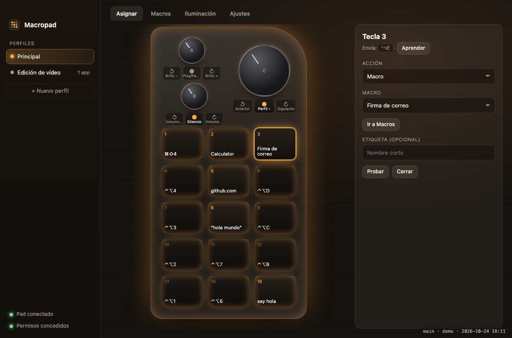
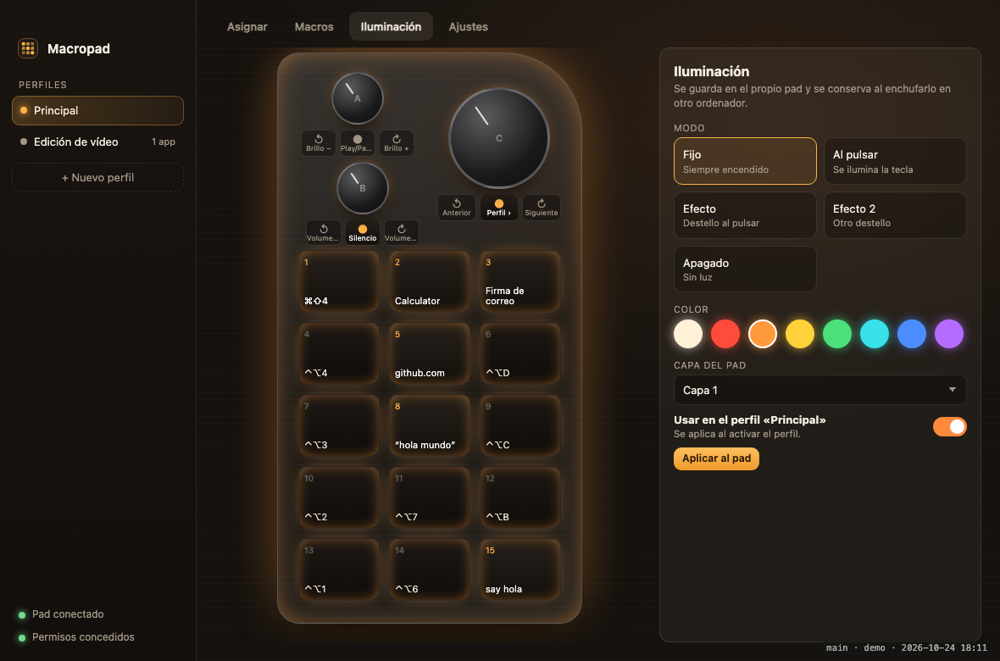

# Macropad

App para macOS que convierte un macro pad USB de **15 teclas y 3 mandos** (chip CH552, `VID 0x1189 · PID 0x8840`, el de la placa `15key_3knob`) en un panel configurable: perfiles, macros, acciones y control del LED. Todo en una sola app nativa con icono en la barra de menú. Sin navegador, sin Python, sin servicios sueltos.



## Qué hace

- **Asignar:** cada tecla y cada mando (girar a izquierda, a derecha y pulsar) lanza lo que elijas: atajo de teclado, texto, macro, abrir app o enlace, comando de shell, tecla multimedia o cambio de perfil.
- **Macros:** secuencias de pasos (atajos, texto, esperas, comandos, apps, enlaces, multimedia).
- **Perfiles:** conjuntos de asignaciones; cada perfil puede activarse solo cuando una app concreta está al frente.
- **Iluminación:** modo, color y capa del LED, guardados en el propio pad. Se envían por HID, **sin sudo**.
- **Asistente de permisos:** comprueba en vivo si el pad está conectado y si macOS ha concedido los permisos.



## Instalar

Requisitos: macOS 13 o superior y las herramientas de línea de comandos (`xcode-select --install`).

```bash
git clone <este repositorio> macropad && cd macropad && ./install.sh
```

El instalador compila la app, la copia a Aplicaciones, la abre y espera a que concedas **Monitorización de entrada** y **Accesibilidad**, mostrando el estado del pad y de cada permiso. La app se registra para abrirse al iniciar sesión (en la barra de menú, sin ventana).

```bash
./install.sh --uninstall   # quitar la app (conserva la configuración)
./install.sh --purge       # quitar la app y su configuración
```

> macOS identifica la app por su firma. Si `build.sh` encuentra un certificado de firma de código en tu llavero lo usa y los permisos sobreviven a recompilar; si no, firma ad-hoc y macOS pedirá los permisos de nuevo tras cada recompilación.

## Cómo funciona

| Pieza | Qué hace |
|---|---|
| `Sources/Engine.swift` | Lee los informes HID del pad (IOHIDManager), los traduce a disparadores, ejecuta las acciones y filtra el evento original con un `CGEventTap` |
| `Sources/Config.swift` | Perfiles, macros y mapa de posiciones; guarda en `~/Library/Application Support/Macropad/config.json` |
| `Sources/Bridge.swift` · `main.swift` | Ventana con `WKWebView`, icono de menú y puente JS ↔ Swift |
| `Resources/ui/` | Interfaz (HTML/CSS/JS) |
| `tools/make-icon.swift` | Dibuja el icono |

**Qué envía el pad** (interfaz de teclado, informe `0x01`, y consumer, informe `0x05`): las teclas mandan `Ctrl+Alt+<tecla>`, y los mandos teclas multimedia (volumen, brillo, pista) y `Cmd+Espacio`. El mapa de fábrica está en `Defaults.slots`; el asistente «Aprender todo» lo rehace si hiciera falta.

**Filtro de la tecla original:** macOS no deja capturar el pad en exclusiva sin root, así que la app descarta el evento original con un filtro de eventos. No distingue dispositivo: una combinación asignada deja de funcionar también en tu teclado normal.

**LED:** informe de salida `0x03` de 64 bytes al interfaz del fabricante (`usagePage 0xFF00`): `03 fe b0 <capa+1> 08 00 00 00 00 00 01 00 <código>` seguido de `03 fd fe ff`, con `código = (color << 4) | modo`. Protocolo tomado de [ch57x-keyboard-tool](https://github.com/kriomant/ch57x-keyboard-tool).

## Límites

- Las asignaciones viven en la app, no en la memoria del pad: si lo enchufas a otro ordenador vuelve a lo de fábrica (el LED sí se conserva).
- El botón *Layer* y el interruptor ON/OFF actúan dentro del pad y la app no los ve.
- Probado con un único pad (`15key_3knob_20230525`).
